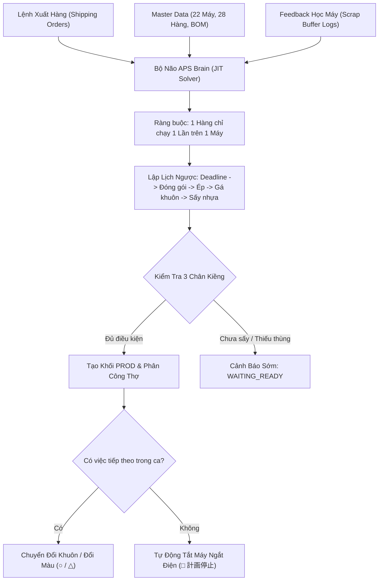

# SYSTEM ARCHITECTURE: MASTER DEV CLEAN ARCHITECTURE
- **Mục đích:** Đặc tả kiến trúc tổng thể, mô hình phân tầng, nguyên tắc phụ thuộc và ranh giới nghiệp vụ (Bounded Contexts).
- **Ngày cập nhật:** 2026-11-20
- **Phạm vi:** Toàn bộ hệ sinh thái Kaisha APS Brain 2.0.
- **Trạng thái:** VERIFIED

---

## 1. MÔ HÌNH PHÂN TẦNG CLEAN ARCHITECTURE
Hệ thống tuân thủ nghiêm ngặt nguyên tắc **Dependency Rule**: Tầng bên trong không phụ thuộc vào tầng bên ngoài.

```
       +-------------------------------------------------------+
       |                  PRESENTATION LAYER                   |
       |  React 18 SPA (Vite, Tailwind, Role Portals, Router)   |
       +-------------------------------------------------------+
                                  |
                                  v (RESTful API / JSON)
       +-------------------------------------------------------+
       |                      API LAYER                        |
       |  EnterpriseRequestHandler -> ApiRouter -> Controllers |
       +-------------------------------------------------------+
                                  |
                                  v
       +-------------------------------------------------------+
       |                    SERVICE LAYER                      |
       |  BrainService, ResourceService, AuthService, Workflow |
       |          (Thuật toán APS JIT, 3 Chân kiềng, Tự học)    |
       +-------------------------------------------------------+
                                  |
                                  v
       +-------------------------------------------------------+
       |                    DOMAIN LAYER                       |
       |  Entities (Machine, Product, Order), Enums, Rules     |
       +-------------------------------------------------------+
                                  ^
                                  |
       +-------------------------------------------------------+
       |               INFRASTRUCTURE LAYER                    |
       |  Repositories (Facade), DatabaseManager, SQL DDL      |
       |             (SQLite WAL / PostgreSQL)                 |
       +-------------------------------------------------------+
```

---

## 2. RANH GIỚI NGHIỆP VỤ (BOUNDED CONTEXTS)
Hệ thống được chia thành 4 phân vùng độc lập theo vai trò vận hành:
1. **Admin / Scheduling Context (`/admin`):**
   - Quản trị viên xưởng (Kawabata): Xem toàn cảnh 22 máy trên bảng Gantt, lập lịch JIT, quản lý BOM, đơn hàng xuất khẩu, nhân sự và quản trị cơ sở dữ liệu.
2. **Technician Context (`/technician`):**
   - Kỹ thuật viên thay khuôn (Miyaji): Tiếp nhận các khối ○ (型替), thực hiện checklist kiểm tra an toàn 4 bước và ký số nghiệm thu bàn giao máy.
3. **Material Management Context (`/material`):**
   - Quản lý nguyên liệu (Edison): Giám sát 4+ phễu sấy hạt nhựa (80°C - 140°C), kiểm tra cờ sấy đặc biệt Dry-coat ($青○$), điều phối thùng KLT/Carton và ký xác nhận cấp liệu.
4. **Operator Workstation Context (`/operator` hoặc `/workstation`):**
   - Thợ đứng máy (Chí, Quỳnh, Hùng A...): Xem chi tiết mã hàng đang chạy, hướng dẫn thao tác, ghi nhận số lượng hoàn thành và báo cáo phế phẩm cuối ca.

---

## 3. SƠ ĐỒ LUỒNG TỐI ƯU HÓA APS JIT (MERMAID)

