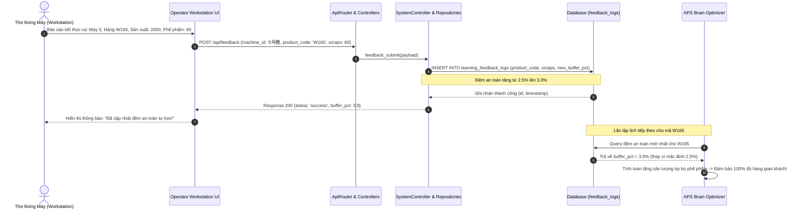

# DATA FLOW: LUỒNG DỮ LIỆU NGHIỆP VỤ HỆ THỐNG
- **Mục đích:** Mô tả chi tiết cách thức dữ liệu di chuyển, chuyển hóa và được lưu trữ trong các luồng vận hành chính.
- **Ngày cập nhật:** 2026-11-20
- **Phạm vi:** Toàn bộ quy trình xử lý dữ liệu của APS Brain.
- **Trạng thái:** VERIFIED

---

## 1. LUỒNG 1: TỐI ƯU HÓA LẬP LỊCH NGƯỢC JIT (JIT SCHEDULING FLOW)
1. **Khởi tạo:** Quản lý xưởng bấm nút "Tối Ưu Hóa Kế Hoạch JIT" trên Admin Portal (`/admin`).
2. **Frontend Dispatch:** `GanttScheduleView` gọi `scheduleApi.optimizeSchedule(date)` $\to$ gửi HTTP POST `/api/optimize`.
3. **API Routing:** `ApiRouter.handle_post` chuyển tiếp payload tới `schedule_controller.optimize`.
4. **Service Execution:** `schedule_controller` gọi `BrainService.optimize_for_date`:
   - Đọc danh sách lệnh xuất hàng (`shipping_orders`) trong ngày từ `schedule_repo`.
   - Đọc Master Data (22 máy, 28 con hàng, BOM, nhân sự) từ `master_data_repo`.
   - Đọc hệ số hao hụt tự học từ `feedback_repo`.
5. **Brain Optimization:**
   - Sắp xếp đơn hàng theo deadline xuất hàng tăng dần.
   - Với mỗi đơn hàng, tính toán tổng số shot ép cần thiết:
     $$\text{Tổng Shot} = \left\lceil \frac{\text{Số lượng Đơn} \times (1 + \text{Buffer})}{\text{Cavity}} \right\rceil$$
   - Tính thời gian ép: $\text{Giờ Ép} = \frac{\text{Tổng Shot} \times \text{Cycle Time}}{3600}$.
   - Truy vết lùi thời điểm bắt đầu ép: $\text{Start} = \text{Deadline} - 1.0 - \text{Giờ Ép}$.
   - Tìm máy phù hợp trong danh sách `compatible_machines` tuân thủ ràng buộc **1 hàng chỉ chạy 1 máy**.
   - Bổ sung khối thay khuôn (○ 1.0h) hoặc đổi màu (△ 0.5h) nếu con hàng trước đó khác khuôn/màu.
   - Thêm khối ngắt điện tắt máy (□ 計画停止) nếu sau đó máy không còn việc.
6. **Persistence:** Lưu lịch trình mới vào bảng `schedules` và các khối công việc vào `job_blocks`.
7. **Phản hồi:** Trả về mã 200 kèm danh sách `JobBlockDTO` cho giao diện cập nhật bảng Gantt.

---

## 2. LUỒNG 2: VÒNG LẶP HỌC MÁY BÙ HÀO HỤT PHẾ PHẨM (FEEDBACK LOOP)

