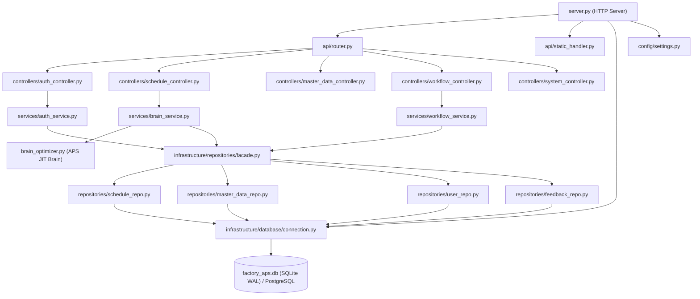
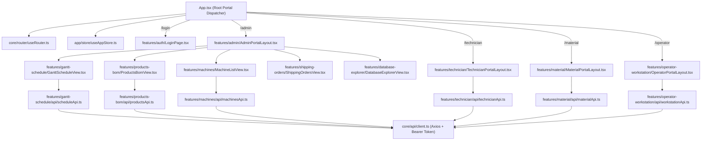

# CODE DEPENDENCY GRAPH: SƠ ĐỒ PHỤ THUỘC CODE
- **Mục đích:** Trực quan hóa quan hệ phụ thuộc giữa các file và tầng kiến trúc bằng Mermaid Graph.
- **Ngày cập nhật:** 2026-11-20
- **Phạm vi:** Toàn bộ dự án `kaisha`.
- **Trạng thái:** VERIFIED

---

## 1. SƠ ĐỒ PHỤ THUỘC TẦNG BACKEND (MERMAID)

---

## 2. SƠ ĐỒ PHỤ THUỘC TẦNG FRONTEND (MERMAID)

